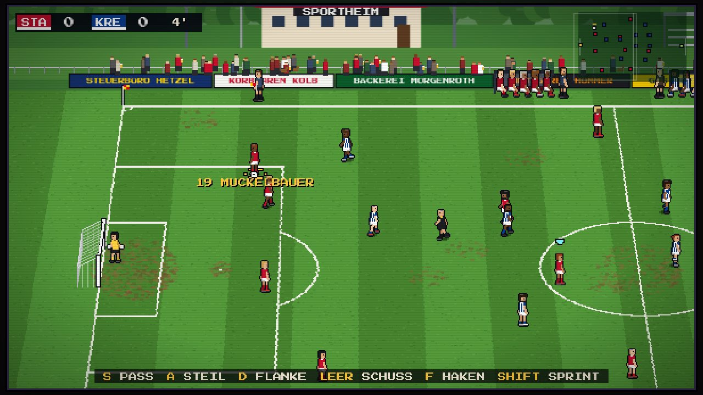
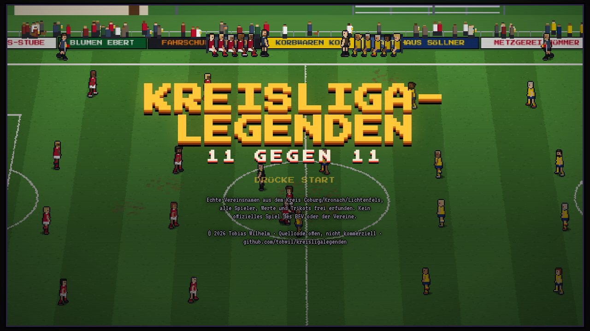
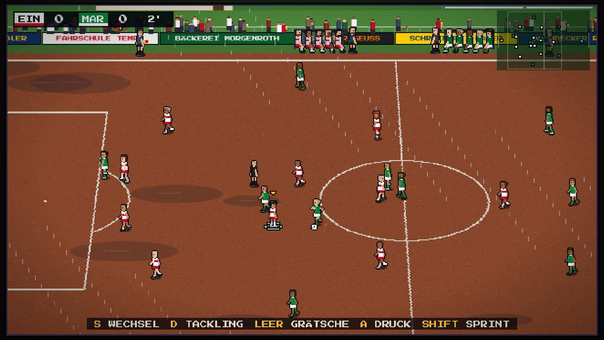
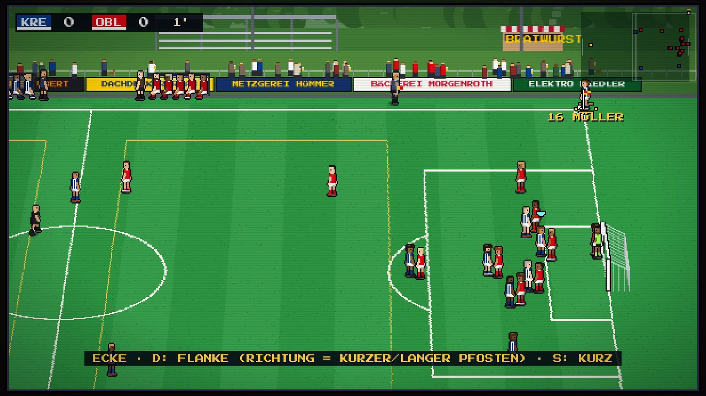
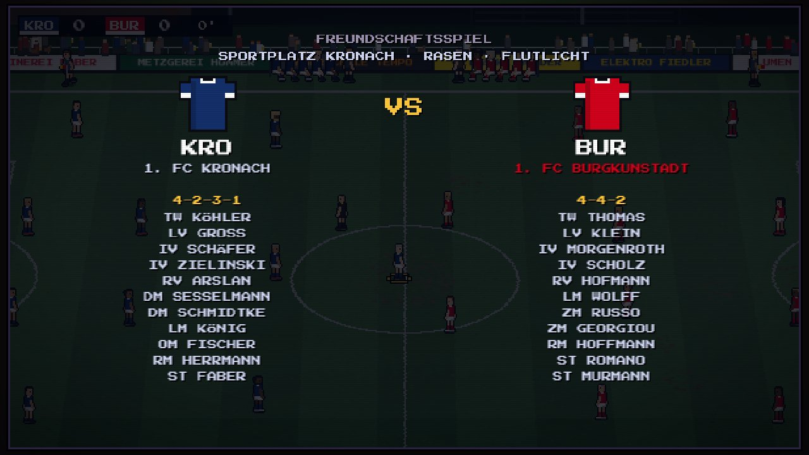
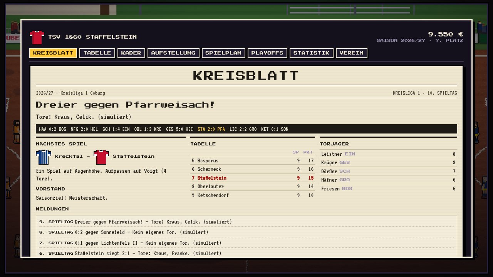
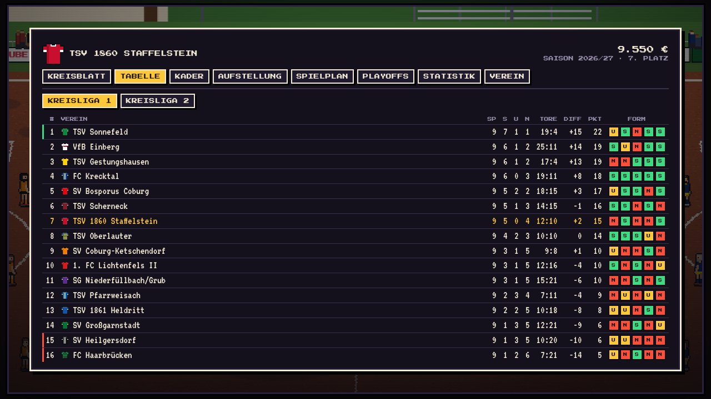
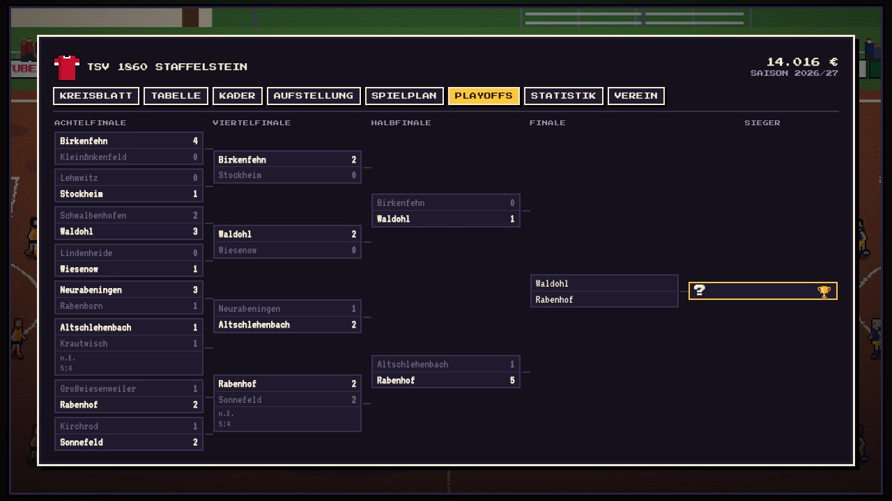
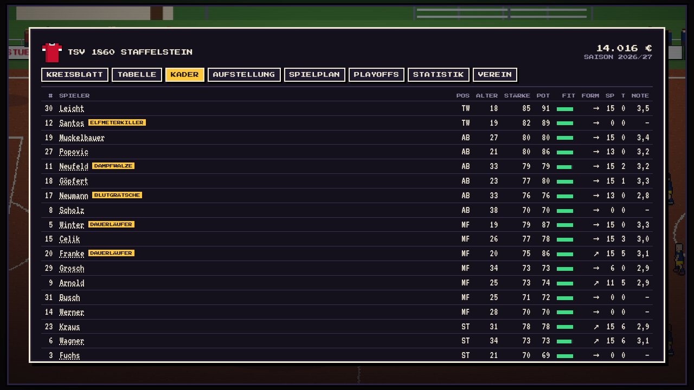
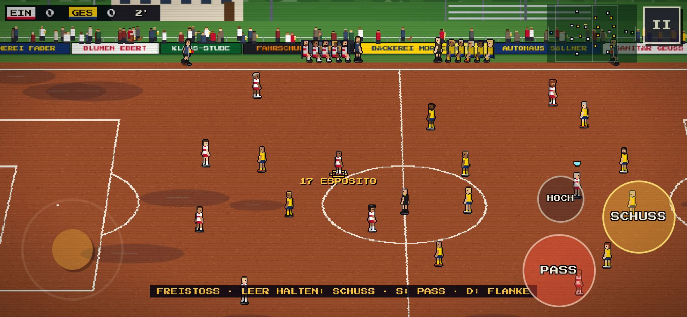

# Kreisliga-Legenden

**Fußball im Retro-Pixel-Look: 11 gegen 11 auf Rasen, Kunstrasen und Hartplatz, mit allen rund 4.900 Vereinen der Kreisligen Deutschlands – aus 238 Kreisen und allen 21 Landesverbänden. Wer Kreismeister wird, spielt in den Playoffs gegen Kreismeister aus ganz Deutschland um die Goldene Eckfahne.** Ein komplettes Browserspiel in einer einzigen HTML-Datei, aus der Familie von [Hallen-Legenden](https://github.com/tobwil/hallenlegenden) und [Korb-Legenden](https://github.com/tobwil/korblegenden).

**[Screenshots](#screenshots) · [Deutsch](#deutsch) · [English](#english)**

## Screenshots

Echte Aufnahmen aus dem Browserspiel. Für die volle Ansicht auf ein Bild klicken.

| Spielgeschehen · Gameplay | Titelbildschirm · Title screen |
|:---:|:---:|
|  |  |
| **Hartplatz bei Regen · Cinder pitch in the rain** | **Ecke · Corner kick** |
|  |  |
| **Aufstellungen unter Flutlicht · Line-ups** | **Kreisblatt · Newspaper** |
|  |  |
| **Tabelle Kreisliga 1 · League table** | **Playoffs der Kreismeister · Playoff bracket** |
|  |  |
| **Kader · Squad** | **Handy quer · Phone landscape** |
|  |  |

---

## Deutsch

Spielen: `game/index.html` im Browser öffnen (am besten mit dem Ordner `fonts/` daneben). Läuft am Desktop mit Tastatur oder Gamepad und auf dem Handy mit Touch-Steuerung (quer). Kostenlos, ohne Werbung, ohne Anmeldung. Die Startseite `index.html` erzählt die Geschichte als Pixel-Film beim Scrollen (`assets/story.js`), dazu Impressum und Datenschutz.

> Die Ligen tragen die echten Vereinsnamen der **höchsten Kreisspielklasse (Herren) aller Kreise in Deutschland, Saison 2026/27, Stand Herbst 2026** – je nach Landesverband heißt sie Kreisliga, Kreisliga A, Kreisoberliga oder A-Klasse. Quelle sind die öffentlichen Tabellen auf fussball.de (siehe `tools/`). Spieler, Trikotfarben, Sportplätze und Werbebanden sind frei erfunden. **Alle Vereine starten gleich stark** (die echten Tabellen sagen über die Stärke zu wenig), erst in der Saison entwickeln sie sich auseinander; die Kreisligen 1 und 2 im Kreis Coburg/Kronach/Lichtenfels sind von Hand gestaltet. Kein offizielles Produkt des DFB, der Landesverbände oder der Vereine. Ein Verein möchte nicht dabei sein? Bitte ein Issue öffnen oder über das Impressum melden.

### Was drin ist

#### Spiel
- **11 gegen 11** auf einem 100 × 64 m großen Platz mit TV-Kamera, die mitschwenkt und sich neigt, dazu ein Radar
- **Aktionen:** Pass mit Vorschau (blaues Dreieck über dem Empfänger), Steilpass in den Lauf, Flanke vom Flügel, hoher Ball, Schuss mit Aufladen (flach, hoch, drüber), Zielkreuz im Tor und gestrichelter Schusslinie, **Schlenzer** an den Innenpfosten und **Heber** über den Torwart, Direktabnahme, Volley und Kopfball, Haken, Doppelpass (wer abspielt, startet von selbst in den Raum)
- **Abwehr:** Tackling (von hinten gibt es Fouls), Grätsche (Ball zuerst treffen!), Spielerwechsel (automatisch oder per Taste), Druck mit einem zweiten Mann
- **Regeln:** Abseits (abschaltbar), Einwurf, Ecke, Abstoß, Freistoß mit Mauer, Elfmeter (der Torwart rät die Ecke), Gelb, Gelb-Rot und Rot (Notbremse), Nachspielzeit, Verlängerung und Elfmeterschießen in K.-o.-Spielen
- **Torwart-KI** mit Paraden, Glanzparaden um den Pfosten und über die Latte, Rauslaufen, Flanken abfangen, Abwurf und Abschlag
- **Taktik & Wechsel** (Q): fünf Formationen (4-4-2, 4-3-3, 4-2-3-1, 3-5-2, 5-3-2), Ausrichtung defensiv/normal/offensiv, fünf Auswechslungen, Kondition
- **Präsentation:** Pixel-Sportplatz mit Sportheim, Tribüne, Flutlicht, Bratwurststand mit Rauch, Burg auf dem Hügel, Zuschauer mit Bierbecher und Hund am Geländer, Banden lokaler Betriebe, Trainerbänke, Schiedsrichter und Linienrichter mit Fahne, Torjubel, Wiederholung, Eisspray
- **Platzarten:** Rasen mit Mähstreifen und abgespielten Stellen, Kunstrasen mit Jugendfeld-Linien, Hartplatz (Asche) mit Pfützen und Staub; das Endspiel unter Flutlicht
- **Ton** komplett synthetisiert: Schuss, Pfiff, Pfosten, Netz, Zuschauer, Autohupe vom Parkplatz, Blaskapellen-Chiptune

#### Saison
- **Jeder Kreisliga-Verein Deutschlands** wählbar: Deutschlandkarte → Landesverband → Kreis → Verein, oder einfach per Suche (keine endlosen Listen)
- Die Kreisligen des eigenen Kreises laufen parallel (bis zu drei Staffeln), Hinrunde oder Hin- und Rückrunde
- **Kreispokal** mit allen Vereinen dieser Staffeln: K.-o.-Runden zwischen den Spieltagen, Freilose, Elfmeterschießen, Finale auf neutralem Platz
- **Playoffs um die deutsche Kreisliga-Meisterschaft:** die Meister des eigenen Kreises und Kreismeister aus ganz Deutschland (möglichst jeder aus einem anderen Landesverband), Achtelfinale bis Endspiel, Turnierbaum
- **Kreisblatt** (Zeitung) mit Schlagzeile, Ergebnis-Ticker, nächstem Gegner, Tabelle, Torjägerliste und Meldungen
- **Kader** mit 18 Spielern (Werte, Alter, Potenzial, Form, Fitness, Verletzungen, Sperren), Spielerkarten mit Spitznamen und Beruf, Noten wie im Kicker (1 bis 6)
- **Aufstellung** (Formation, Startelf, Elfmeterschütze), Training mit Schwerpunkt, Vereinskasse (Eintritt, Bratwurst, Sponsoren, Prämien), Wechselbörse mit Handgeld
- **Mehrere Saisons:** Spieler entwickeln sich, Ältere hängen die Schuhe an den Nagel, Junge kommen aus der A-Jugend. Vereine oben in der Tabelle locken bessere Spieler an, Absteiger verlieren ihre Besten – so entstehen mit jeder Saison echte Favoriten und Außenseiter
- Jedes Spiel **selbst spielen, zuschauen oder simulieren**
- **Vor dem Spiel:** Vergleich beider Vereine (Tabelle, Form, Stärke, Torjäger, bester Spieler, Hinspiel), dann Anpfiff, Zuschauen oder Simulieren
- **Historie:** Vereinschronik, Rekorde (höchster Sieg, Serien, meiste Punkte und Tore), Auszeichnungen am Saisonende (Torschützenkönig, Spieler der Saison, Vorlagenkönig, bester Torwart, Talent), Vereinslegenden; die Saison als Kreisblatt-Seite (1080 × 1350) teilen
- **Spielstände sicher:** Ein laufendes Spiel wird beim Verlassen der Seite gespeichert (Handy im Hintergrund) und lässt sich im Hauptmenü fortsetzen; in der Pause SPEICHERN & BEENDEN. Die Saison merkt sich zu jedem Verein Name und Kreis und ordnet nach neuen Vereinsdaten richtig zu; ein unpassender Stand wird beiseitegelegt statt gelöscht. Spielstand als Datei sichern und laden (Verein-Reiter)
- **Eigener Verein:** Verein nicht dabei? Name, Kurzname, Kürzel, Trikotfarben, Muster und Platz selbst festlegen – er spielt in der gewählten Kreisliga mit. Echte Vereine bekommen auf Wunsch ein eigenes Trikot
- **Spieler bearbeiten:** Name, Spitzname, Rückennummer, Position und Aussehen (Haut, Haare, Frisur, Bart, Bauch) der eigenen Spieler – die Werte bleiben, wie sie sind
- **Derbys** gegen den Erzrivalen aus der eigenen Liga: mehr Stimmung, Prämie, eigene Schlagzeilen

#### Motivation
- **Drei Aufgaben pro Spiel** (zum Beispiel Kopfballtor, zu null spielen, Doppelpass), in der Saison mit Prämie
- **26 Erfolge** und **Legenden-Punkte** mit Stufen, eigenes Menü
- **Zeitlupe** kurz vor Toren, **Jubel selbst wählen** (Knie-Rutscher, Flieger, Becker-Faust), Banner für Doppelpass, Ausgespielt, Traumtor, Hattrick
- **Ergebnis teilen:** Pixel-Zeitungsausschnitt aus dem Kreisblatt (1080 × 1080) fürs Handy oder als Download

### Steuerung

Spielgefühl zwischen EA FC und International Superstar Soccer: schnelle Pässe, der angespielte Mitspieler läuft dem Ball entgegen und nimmt ihn sicher an. Drei Tastatur-Belegungen (Optionen oder Steuerung), Standard ist **Legenden** – wie bei Hallen- und Korb-Legenden.

| Aktion | Legenden (Standard) | WASD + IJKL | EA FC klassisch |
|---|---|---|---|
| Laufen | Pfeile | W A S D (oder Pfeile) | Pfeile |
| Pass · Abwehr: Spieler wechseln | S | K | S |
| Schuss (antippen = platziert, halten = fester) | Leertaste | L | D / Leertaste |
| beim Aufladen: Schlenzer · Heber | S · D | K · J | S · A |
| Flanke / hoher Ball | D | J | A |
| Abwehr: Tackling · Grätsche | D · Leertaste | L · J | D · A |
| Steilpass · Abwehr: Druck | A | I | W |
| Haken | F | U / O | Q |
| Sprint | Shift / W | Shift / Leertaste | Shift / E |
| Taktik · Pause | T · Esc | T · Esc | T · Esc |

**Freistoß und Elfmeter:** Die Kamera wechselt hinter den Ball, man sieht Tor, Torwart und Mauer. Richtung verschiebt das Fadenkreuz (links/rechts, hoch/runter), Schuss halten = Kraft: wenig Kraft gibt einen Bogen über die Mauer, viel Kraft einen harten, flachen Schuss. Die Mauer springt.

Gamepad wie EA FC: Stick laufen · A Pass/Wechsel · B Schuss/Tackling · X Flanke/Grätsche · Y Steilpass/Druck · LB Haken · RT Sprint · Select Taktik · Start Pause.
Touch mit nur zwei Knöpfen – antippen = Hauptaktion, gedrückt halten und ziehen = zweite Aktion, man muss keinen dritten Knopf suchen: PASS (tippen = kurzer Pass, halten = fester und weiter mit türkisem Balken, wischen = Steilpass, nach oben wischen = Flanke/hoher Ball) · SCHUSS (halten lädt auf; Daumen ziehen = Zielkreuz im Tor verschieben, dabei kurz Zeitlupe wie bei Padel-Legenden; leicht in die Ecke = Schlenzer, leicht gegen einen herausgelaufenen Torwart = Heber). Abwehr: WECHSEL (halten = Druck) · TACKLING (ziehen = Grätsche) · Gegner antippen = zu ihm wechseln. Stick links (weit ziehen = Sprint), Mitspieler antippen = Pass zu ihm, eigenen Spieler antippen = Haken. Knopfgröße in den Optionen, Tipp in den ersten zwei Spielen. Lässt du den Stick los, spielt dein Mann nach 0,8 s von selbst mit.

**Arcade-Hilfen** (wie bei ISS und EA FC, je nach Schwierigkeit stärker oder schwächer): Der Pass sucht in Stickrichtung den Mitspieler, der den Ball sicher bekommt. Steht ein Gegner zufällig in der Passlinie, greift er nicht immer zu. Läuft dein Verteidiger dem Ballführer in den Ball, spitzelt er ihn weg. Dein Tackling sitzt etwas öfter. Ein kurzer Treffer-Stopp beim Hammer und beim Ballgewinn. Flanken: Ein gelber Ring zeigt, wo ein hoher Ball in Kopfhöhe ankommt. Dein Stürmer läuft zum Ball und köpft im Strafraum von selbst aufs Tor (Pass vorgemerkt = ablegen); in der Abwehr köpft dein Spieler mit Schuss/Tackling weg (Stickrichtung) oder mit Pass zum Mitspieler. Auf dem Handy schwenkt die Kamera am Tor so weit, dass Knöpfe und Stick das Tor nicht verdecken.

### Entwicklung

Der Quelltext liegt in `src/` (Module `p01_core.js` bis `p16_picker.js`, Gerüst und Styles in `head.html`, Vereinsdaten in `d_vereine.js`, Karte in `d_karte.js`). Die Vereinsdaten erzeugen `tools/vereine_crawl.py` (öffentliche Tabellen auf fussball.de) und `tools/vereine_build.py`, die Karte `tools/karte_raster.py` (Natural Earth, gemeinfrei). `sh src/build.sh` baut daraus `game/index.html`, das mit committet wird.

Tests (Playwright mit Chromium): `cd tests && npm install && npm test`. Sie spielen ganze Spiele Bild für Bild durch, prüfen Regeln, Standards, Elfmeterschießen, die Vereinsdaten und die Kartenauswahl, zwei komplette Saisons mit Kreispokal und Playoffs, das Training, Menüs mit Pfeiltasten und die Touch-Steuerung. Die GitHub Action prüft außerdem, dass `game/index.html` zu `src/` passt.

Lizenz: [PolyForm Noncommercial 1.0.0](LICENSE) · Schriften: Press Start 2P und VT323 (SIL Open Font License).

---

## English

**Retro pixel football (soccer): 11 vs 11 on grass, artificial turf and cinder pitches, featuring all ~4,900 real clubs of Germany's district leagues ("Kreisliga") from 238 districts and all 21 regional FAs. Pick your club on a map of Germany, win your league and the district cup, then take on district champions from all over the country in a knockout playoff for the Golden Corner Flag.** A complete browser game in a single HTML file, from the family of Hallen-Legenden (handball) and Korb-Legenden (basketball).

Club names are the real names of the 2026/27 top district league clubs (source: public tables on fussball.de); all players, ratings, kits, pitches and ads are fictional. Not an official product of the DFB, the regional FAs or the clubs. A club wants to be removed? Please open an issue.

Play: open `game/index.html`. Keyboard (default: arrows to run, S pass, Space shoot, D cross/tackle, A through ball, Shift sprint; alternative layouts WASD + IJKL and EA FC classic), gamepad (FC layout) or touch. While charging a shot, a reticle in the goal shows where it goes; pass while charging = finesse shot, cross = chip. Free kicks and penalties switch to a camera behind the ball with an aiming reticle. Season mode with a newspaper, squad, lineup, training, transfers and multiple seasons. Source in `src/`, build with `sh src/build.sh`, tests with `cd tests && npm install && npm test`.
